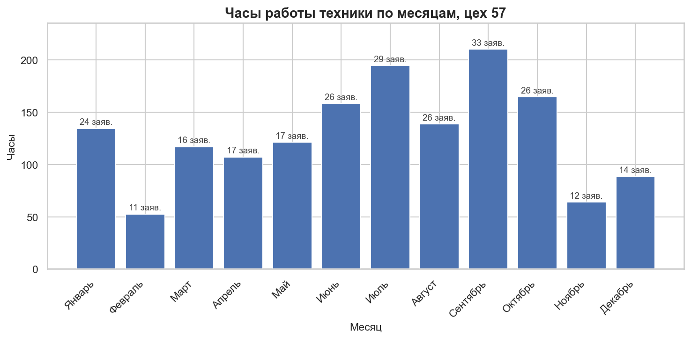
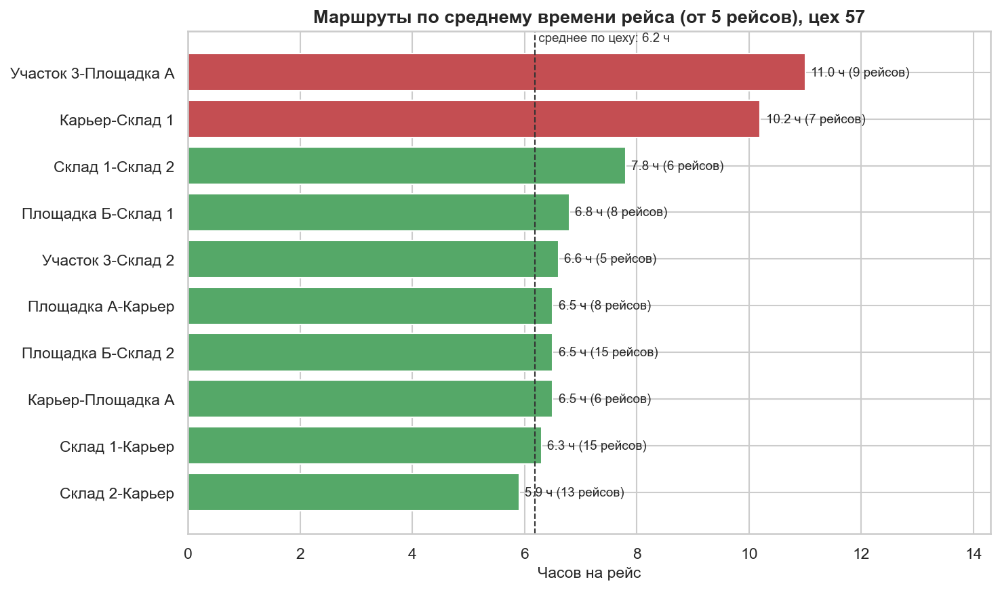
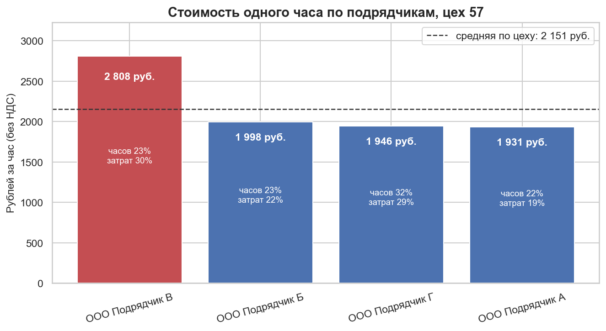
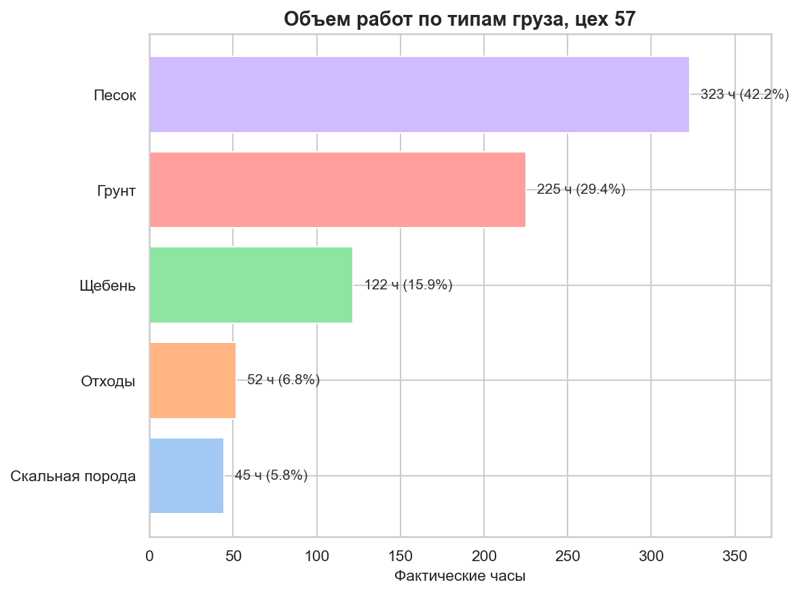

# Сверка и обогащение логистических реестров: ETL-пайплайн на pandas

ETL-пайплайн, который сверяет ручные реестры подрядчиков с выгрузкой из системы 1С:TMS: очищает «грязные» номера заявок, объединяет таблицы в два этапа и подтягивает недостающие поля (маршрут, тип груза, статус заявки). Поверх объединённых данных строится небольшая аналитика по затратам и загрузке техники.

> **Все данные в репозитории синтетические.** Их создаёт скрипт `generate_data.py`, закономерности в них заложены намеренно. Проект показывает **метод** очистки, объединения и поиска отклонений, а не реальные выводы о каком-либо предприятии.

---

## Бизнес-проблема

Данные о фактической работе подрядчиков собираются в **ручных реестрах**. В них:

1. **Номера заявок записаны по-разному:** `А0012345`, `ЦП/057762`, `79703 от 06.04`, `59756\nдоп`.
2. **Нет справочных данных:** адресов погрузки и разгрузки, типа груза, статуса заявки.

Эти данные есть в выгрузке **1С:TMS**, но номера заявок и там неаккуратные: буквы-приставки, пробелы внутри числа, ведущие нули.

Прямое объединение по номеру и дате на этих данных совпадает всего у **1,0% строк** (8 из 800).

---

## Решение

### 1. Нормализация номеров с обеих сторон
- В отчёте 1С убираются пробелы, буквы-приставки (кириллица и латиница, оба регистра) и ведущие нули.
- В реестре дополнительно разбираются составные форматы: слэш, «от», скобки, перенос строки.

### 2. Объединение в два этапа
- **Этап 1:** точное объединение по `Номер + Дата заявки` (с проверкой `validate='m:1'`, чтобы дубль ключа в отчёте не размножил строки).
- **Этап 2:** для строк без пары запасное объединение по `Дата + Тип ТС + Код цеха`.

Колонка `Источник` (`1_часть` / `2_часть`) показывает, каким способом найдена пара.

### 3. Обогащение
К каждой найденной строке реестра подтягиваются `Адрес отправления`, `Адрес получения`, `Тип груза`, `Статус заявки`.

---

## Результат объединения

| Метрика | Значение |
|---|---:|
| Строк в реестре | 800 |
| Найдено на этапе 1 (номер + дата) | 735 (91,9%) |
| Строк, ушедших на этап 2 | 65 (8,1%) |
| …из них пара найдена запасным ключом | 39 |
| …из них пары в отчёте нет вовсе | 26 (3,3%) |
| **Обогащено строк** | **774 (96,8%)** |
| Потеряно строк при объединении | 0 |
| Совпадение прямым объединением без очистки | 8 (1,0%) |

Контроль целостности встроен в `main.py`: число строк до и после объединения сравнивается, разбивка по способам выводится в консоль.

---

## Что показывает аналитика (цех 57)

> Закономерности ниже заложены генератором данных. Это пример того, как они находятся.

### Графики






### Выводы

**1. Стоимость часа у подрядчика «В» выше.** 2 808 ₽/ч против 1 957 ₽/ч у остальных подрядчиков (+43%; к средней по цеху 2 151 ₽/ч это +31%). При этом у него 22,8% часов и 29,7% затрат. Если бы его объём оплачивался по ставке остальных, экономия составила бы около 300 тыс. ₽ (353,8 ч × разница ставок). Оценка верна при допущении, что виды работ сопоставимы.

**2. Два маршрута занимают в 1,6–1,8 раза больше времени.** «Участок 3 → Площадка А»: 11,0 ч на рейс (9 рейсов). «Карьер → Склад 1»: 10,2 ч (7 рейсов). Среднее по цеху 6,2 ч, остальные маршруты в диапазоне 5,9–7,8 ч. Проверка перестановками: при случайном перемешивании часов такой максимум не получился ни разу из 2 000 попыток.

**3. Заявок больше летом и в сентябре.** Июнь–август: 81 заявка, декабрь–февраль: 49. Максимум в сентябре (33 заявки, 210 ч), минимум в феврале (11 заявок, 53 ч). Выборка небольшая (11–33 заявки в месяц), поэтому выводов о причинах не делаю.

**4. Структура грузов.** Среди грузовой техники: песок 42,2% часов, грунт 29,4%, щебень 15,9% (вместе 87,5%).

---

## Ограничения

- **Данные синтетические**, и генератор создавался вместе с очисткой: «100% верных совпадений на этапе 1» подтверждает, что код согласован с форматами, которые я заложил. На реальных реестрах придётся добавлять правила.
- **Запасной ключ неоднозначен.** Если в один день у одного цеха несколько заявок на один тип ТС, берётся первая из них. В реальных данных точность этапа 2 будет ниже, чем здесь.
- **Охват разрезов:** маршруты считаются по 94,7% часов цеха (остальное строки без пары), тип груза по 49,4% (груз указан только у грузовой техники).
- **Статус «Не указан»** объединяет два случая: «нет пары в отчёте» и «статус в отчёте пуст».
- **Малая выборка:** 251 заявка в цехе 57, по месяцам и маршрутам цифры колеблются.

---

## Структура проекта

```text
transport-data-reconciliation/
├── main.py                 # ETL-пайплайн: очистка, объединение, агрегации, графики
├── generate_data.py        # генератор синтетических «грязных» данных
├── requirements.txt
├── README.md
├── docs/                   # примеры графиков для README
├── data/                   # входные файлы (создаются генератором, не в репозитории)
└── output/                 # результаты (создаются пайплайном, не в репозитории)
```

---

## Как запустить

Команды выполняются из корня проекта.

```bash
pip install -r requirements.txt
python generate_data.py     # создаст папку data/ с тремя Excel-файлами
python main.py              # очистка, объединение, агрегации, графики -> output/
```

---

## Стек и приёмы

Python 3.10+, pandas (`merge` с `indicator` и `validate`, `agg` с именованными колонками, `reindex`), NumPy, Matplotlib и Seaborn, openpyxl.

Что в проекте сделано: разбивка на функции, константы вынесены наверх, проверки качества данных (невалидные даты, число строк до и после объединения), защита от пустых данных и отсутствующих месяцев.

---

## Об авторстве

Логика очистки и объединения основана на рабочих скриптах, которые я писал для анализа реестров подрядчиков (здесь переписаны на синтетических данных). Для генератора данных, визуализации и ревью кода я использовал ИИ-ассистента.
